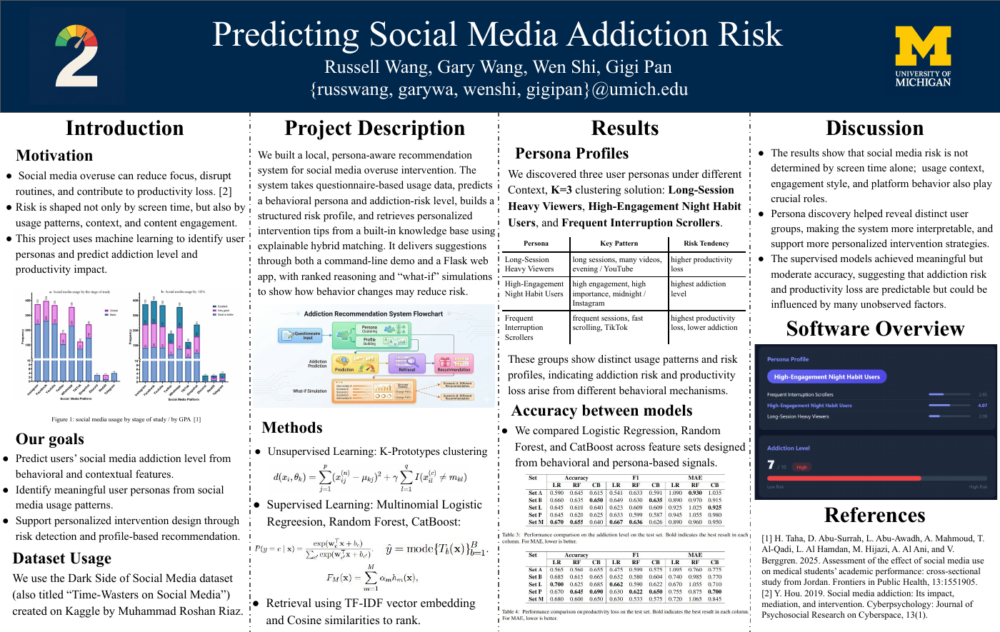

# Social Media Behavior Insights

**Persona-aware social media risk assessment and personalized recommendation system.**

A research prototype that goes beyond *screen time* to explore how usage context, session frequency, content engagement, and time of day relate to self-reported social media addiction and productivity loss. It combines supervised classification, behavior-based personas, interpretable recommendations, and an interactive web interface.



[View the full project poster (PDF)](docs/research-poster.pdf)

## What it does

- **Behavioral profiling:** Assigns a questionnaire response to one of three personas based on weighted matching against prototypes derived from the exploratory clustering analysis: **Long-Session Heavy Viewers**, **High-Engagement Night Habit Users**, and **Frequent Interruption Scrollers**.
- **Risk prediction:** Uses a saved multinomial logistic-regression model to estimate a self-reported **addiction-level label (1–10)** from platform, time spent, session count, and watch time.
- **Personalized suggestions:** Filters a local knowledge base and ranks behavioral suggestions using Sentence-BERT cosine similarity when available, with a transparent rule-based fallback. **No generative AI API is needed.**
- **What-if exploration:** Compares *model predictions* under illustrative behavior changes (shorter screen time, fewer sessions, earlier use, different platform). These are **not causal estimates**.
- **Model experimentation:** Includes code and saved evaluation metrics for Logistic Regression, Random Forest, and CatBoost across multiple feature sets and two targets: addiction level and productivity loss.

## Quick start

Use **Python 3.11**; the bundled model artifact was serialized with **scikit-learn 1.5.2** and may not load with later versions.

```bash
git clone https://github.com/Russellwangz/social-media-behavior-insights.git
cd social-media-behavior-insights
python3.11 -m venv .venv
source .venv/bin/activate            # Windows: .venv\Scripts\activate
python -m pip install -r requirements.txt
python web_app.py
```

Open **http://127.0.0.1:5000** to use the questionnaire, results, recommendations, and what-if simulations. A command-line example is also available:

```bash
python app.py
```

The default installation uses **rule-based fallback retrieval**, so it does not need to download an embedding model. For optional semantic ranking, install:

```bash
python -m pip install -r requirements-embeddings.txt
```

On first use with Sentence-BERT enabled, `efederici/sentence-bert-base` is downloaded from Hugging Face. Without it, the system still produces ranked recommendations using persona, severity, and feature-overlap heuristics.

## System design

```text
Questionnaire response
      |
      +--> Weighted persona-prototype matching --------+
      |                                                |
      +--> Saved logistic-regression risk model -------+
                                                       |
                                               Structured risk profile
                                                       |
                                               Local knowledge base
                                                       |
                                        Filter + rank relevant suggestions
                                                       |
                                        Explanation + what-if comparisons
```

All inference happens locally. Suggestions are assembled from the knowledge base using a deterministic response template rather than an LLM.

## Research methodology and results

The research used the **Dark Side of Social Media (Time-Wasters on Social Media)** dataset by **Muhammad Roshan Riaz** on [Kaggle](https://www.kaggle.com/datasets/muhammadroshaanriaz/time-wasters-on-social-media). It contains **1,000 rows and 31 columns** in the project copy. The supervised experiments compare Logistic Regression, Random Forest, and CatBoost across behavioral and contextual feature sets. Training uses a stratified 80/20 train/test split and a validation split within the training portion (configuration in `SupervisedCode/src/config.py`).

The saved test-set metrics include:

| Task and feature set | Model | Test accuracy | Macro-F1 |
| --- | --- | ---: | ---: |
| Addiction level · Platform pattern | Logistic Regression (deployed) | **67.0%** | **0.672** |
| Productivity loss · Content/behavior interactions | Logistic Regression | **70.0%** | **0.662** |

These are **individual experiment results**, not clinical performance measures or evidence of causality. The poster discusses K-Prototypes persona discovery; the included inference implementation uses fixed, weighted prototypes. A script to retrain the K-Prototypes clustering stage is **not included** in this archive.

The complete saved validation/test metric JSONs are in `SupervisedCode/outputs/metrics/`. See [the training pipeline](SupervisedCode/README.md) for reproduction steps.

## Project structure

```text
app.py                                # CLI demonstration / inference orchestration
web_app.py                            # Flask app and what-if endpoints
templates/index.html                  # Interactive questionnaire UI
existing_predictors/                 # Persona matching and saved-model inference
profile_builder.py                    # User profile and behavioral risk flags
knowledge_base.py                     # Local recommendation content
retriever.py                          # Sentence-BERT ranking + rule-based fallback
generator.py                          # Template-based suggestion report
final_models/                         # Small bundled model needed for inference
SupervisedCode/                       # Training, feature engineering, evaluation
  src/                                # Data preprocessing, model training, metrics
  scripts/run_all.py                  # Experiment runner
  outputs/metrics/                    # Saved experiment results
experiments/                          # Stand-alone persona matching exploration
docs/                                 # Research poster and preview
tests/                                # Integration tests
```

## Training and data

The original third-party CSV and large generated model artifacts are **not bundled in this publication-ready repository**. To reproduce the model experiments, download the dataset from the [original Kaggle page](https://www.kaggle.com/datasets/muhammadroshaanriaz/time-wasters-on-social-media), place the extracted CSV at `SupervisedCode/data/raw/time_wasters.csv`, then run:

```bash
python SupervisedCode/scripts/run_all.py
```

The trained model used for the **web/CLI demo is included** in `final_models/`, so dataset download is **not** required to run the demo.

## Tests

```bash
python -m pytest -q
```

**Compatibility:** Scikit-learn estimators saved with older versions are not guaranteed to deserialize with newer versions. Use the Python/scikit-learn versions above and only load serialized models from trusted sources.

## Limitations and responsible use

This is an **educational/research prototype**, not an addiction diagnosis or clinical screening instrument. The labels are dataset-defined and self-reported, and subgroup/generalization performance has not been established. The what-if feature changes model inputs; it does **not** demonstrate that a suggested behavioral intervention will cause an outcome. The ranking heuristics also reflect design choices rather than validated recommendations.

## Contributors and acknowledgments

**Russell Wang, Gary Wang, Wen Shi, Gigi Pan** — University of Michigan project team (as credited in the research poster). Dataset credit: Muhammad Roshan Riaz, *Dark Side of Social Media* (Kaggle). Third-party dataset rights remain with their respective owners; no license is granted here for redistributing that dataset.
